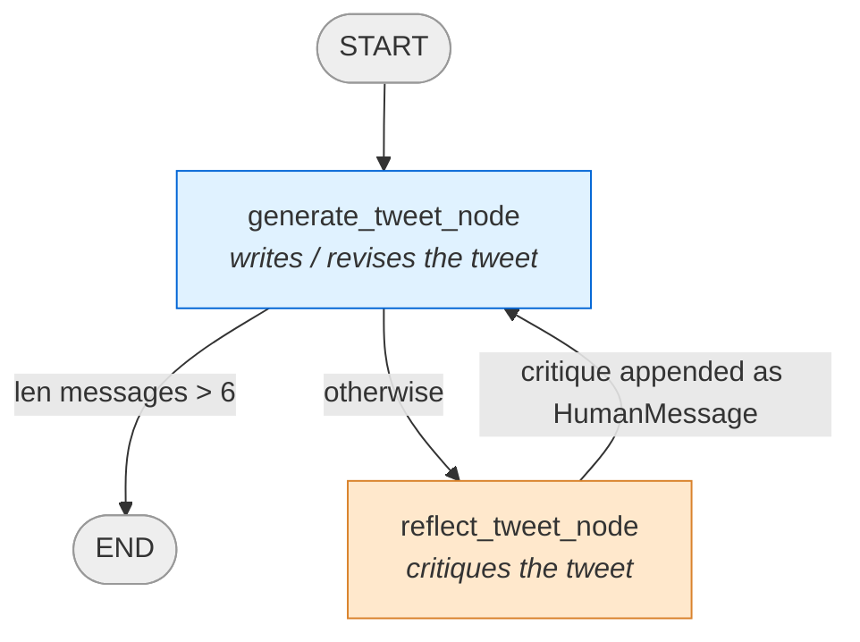
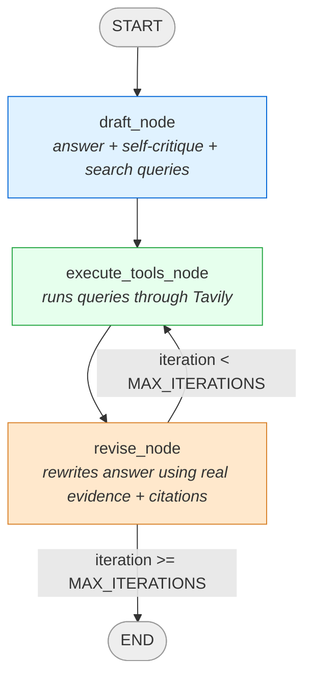

# Reflection & Reflexion Agents

Two small LangGraph projects that explore the same underlying idea — an LLM improving its own output through a loop — at two different levels of sophistication:

- **`reflection-agent/`** — a plain reflection loop. Generate, critique, revise, repeat. No new information ever enters the loop; the LLM only ever argues with its own previous opinion.
- **`reflexion-agent/`** — a Reflexion loop (from the "Reflexion: Language Agents with Verbal Reinforcement Learning" pattern). Same generate/critique/revise shape, but each round also runs real web searches and folds real evidence into the revision, with citations.

Read `reflection-agent` first — it's the simpler mental model. `reflexion-agent` is what you get when you ask "what's actually missing from reflection?" and go build it.

---

## Part 1 — `reflection-agent`

### What it does, in one sentence

Give it a topic, and two roles — a "tweet writer" and a "harsh critic," both played by the same LLM — take turns writing and critiquing a tweet until a message limit is hit. The last tweet written is the answer.

### The loop, step by step

1. **`generate_tweet_node`** — plays the tweet writer. Takes everything in `state["messages"]` so far (the original request, plus any past critique) and either writes a fresh tweet or revises the previous one.
2. **`should_continue`** checks `len(state["messages"])`:
   - `> 6` → go to `END`
   - otherwise → go to `reflect_tweet_node`
3. **`reflect_tweet_node`** — plays the critic. Reads the tweet just written and generates critique (length, virality, style, etc).
4. That critique gets appended back into `messages`, disguised as a `HumanMessage` — not because a human sent it, but because `generation_prompt` is written to say *"if the user provides a critique, respond with a revised version"*. The critic's output has to look like it came from "the user" for that instruction to trigger.
5. Loop back to step 1. The generator now sees its own tweet plus the critique, and revises. Repeat until the cutoff.

### Why disguise the critique as `HumanMessage`?

Look at `prompts.py`:
```python
generation_prompt = ChatPromptTemplate.from_messages([
    ("system", "...If the user provides a critique, respond with a revised version of your previous attempts."),
    MessagesPlaceholder(variable_name="messages")
])
```
The system prompt only knows how to react to "the user" giving feedback. There's no separate mechanism for "an AI critic said this" — so `reflect_tweet_node` wraps its critique in `HumanMessage(...)` purely to satisfy that instruction. It's a role-play trick, not an actual human in the loop.

### `MessagesPlaceholder` — the part that trips people up first

`MessagesPlaceholder(variable_name="messages")` is a gap in the prompt template that says *"insert a whole list of messages here, not just one string."* Compare it to the `("system", "...")` line above it in the same template — that's one fixed message that never changes. The placeholder is the opposite: at invoke time, whatever list is passed under the key `"messages"` gets unpacked into the prompt, each item becoming its own message.

```python
generation_chain.invoke({"messages": state["messages"]})
```
The key `"messages"` here must match `variable_name="messages"` in the placeholder — that's the entire connection between them. If `state["messages"]` has 3 items, the final prompt sent to the LLM has 4 messages total: the fixed system message, plus those 3 unpacked in order.

Why not just hardcode messages into the template? Because the conversation *grows* every loop iteration (1 message → 3 → 5 → ...) and the template has to accept a variable-length history, not a fixed shape.

### `generation_chain = generation_prompt | llm` — what the `|` actually does

This is LangChain's pipe operator: *"build the prompt, then feed the result straight into the LLM, automatically."* So calling `generation_chain.invoke({"messages": ...})` does two steps in one call:
```python
prompt = generation_prompt.invoke({"messages": state["messages"]})  # fill the placeholder
response = llm.invoke(prompt)                                        # send it
```
`reflect_tweet_node`'s `reflection_chain` works identically, just with the critic's system prompt instead.

### Why the message list doesn't spiral out of control (yet)

Every node call re-sends the *entire* accumulated `messages` list to the LLM — nothing is ever trimmed or summarized. In principle this is real bloat: by round 3, you're re-sending the original request *and* every past tweet *and* every past critique, even the ones that are now obsolete.

It stays cheap here purely because `should_continue` caps the loop hard at 6 messages (3 rounds). If that cap were raised to, say, 50, every single LLM call would resend up to 50 messages' worth of tokens — cost and latency scaling linearly with loop length. Real production agents solve this with summarization or trimming; this toy project sidesteps the problem by staying short-lived on purpose.

### State

```python
class MessageState(TypedDict):
    messages: Annotated[List[BaseMessage], add_messages]
```
One field. `add_messages` is the reducer — every node's returned `{"messages": [...]}` gets **appended** to the running list, never overwrites it. This shared, ever-growing list is the entire memory of the loop; both roles read from the same one.

### `should_continue`'s `path_map`

```python
builder.add_conditional_edges(
    "generate_tweet_node", should_continue,
    path_map={END: END, "reflect_tweet_node": "reflect_tweet_node"}
)
```
`path_map` is an explicit lookup table: *"here are the only values `should_continue` can return, and here's the real node each one maps to."* Without it, LangGraph tries to infer valid destinations by reading the function's code. Here the keys and values are identical to what `should_continue` already returns, so the `path_map` isn't changing behavior — it's just making the routing explicit instead of inferred. (It becomes genuinely useful when a function returns short labels like `"yes"`/`"no"` and `path_map` translates those into real node names.)

### `src/main.py` vs `src/reflection_graph.py`

Two independent, functionally identical builds of the same graph:
- **`reflection_graph.py`** — uses `ChatPromptTemplate` + `MessagesPlaceholder` (the declarative style, described above).
- **`main.py`** — a hand-written version using the raw technique instead: `llm.invoke([SystemMessage(content=prompt)] + state["messages"])`, no prompt template object at all. Written independently to prove the pattern was actually understood, not just copied.

Both are registered in `langgraph.json` under different graph IDs (`reflection_graph` and `reflection_graph_manual`) so they can be run and compared side by side in LangGraph Studio.

### Mermaid: `reflection-agent`



---

## Part 2 — `reflexion-agent`

### What it does, in one sentence

Same generate → critique → revise shape as reflection, but the critique step produces concrete search queries, those queries actually get run against Tavily for real sources, and the revision step rewrites the answer using that real evidence — with numbered citations.

### Why this is a different pattern, not just "reflection but bigger"

| | `reflection-agent` | `reflexion-agent` |
|---|---|---|
| Judge of quality | Another LLM call's opinion, nothing else | Same, plus real search results as evidence |
| What changes between rounds | Just the LLM's own wording | The LLM's wording *and* the facts it has access to |
| Memory across rounds | Full raw message history, replayed every time | Structured fields (`draft`, `revised`, `search_results`) — no chat history replay at all |
| Output shape | Free-form text | Structured Pydantic objects, enforced by the schema |

The core addition, in one line: **reflection critiques an opinion; Reflexion goes and checks facts, then critiques again with those facts in hand.**

### The state

```python
class ReflexionState(TypedDict):
    task: str                                  # the original question
    draft: Optional[AnswerQuestionObject]       # first-pass answer + self-critique + search queries
    search_results: Annotated[List[str], add]   # grows every time execute_tools_node runs
    revised: Optional[ReviseAnswerObject]       # latest revised answer, now with citations
    iteration: int                              # how many draft/revise rounds have happened
```
Notice this is *not* a `messages` list like the reflection agent. Instead of replaying an ever-growing chat transcript, each node reads and writes specific, named fields. `search_results` is the one field with a reducer (`add`) — every `execute_tools_node` run appends its findings onto the pile, since older search results stay relevant across rounds. Everything else (`draft`, `revised`, `iteration`) just gets overwritten with the latest value, because only the *most recent* draft/revision/count matters.

### The two structured-output schemas

```python
class AnswerQuestionObject(BaseModel):
    answer: str            # ~250 word answer
    reflection: str        # self-critique of that answer
    search_queries: List[str]  # 1-3 queries to research improvements

class ReviseAnswerObject(AnswerQuestionObject):
    references: List[str]  # citations for the revised answer
```
`ReviseAnswerObject` extends `AnswerQuestionObject` — it inherits `answer`/`reflection`/`search_queries` and adds `references`. This is what lets the revise step demand citations while the first draft doesn't need any yet (there's nothing to cite before a search has even happened).

```python
responder_llm = llm.with_structured_output(AnswerQuestionObject)
revisor_llm = llm.with_structured_output(ReviseAnswerObject)
```
`.with_structured_output(SomeModel)` forces the LLM's response to come back as a real instance of that Pydantic class — `.answer`, `.reflection`, `.search_queries` as actual attributes, not something you have to parse out of free text yourself. This replaces an older, more manual technique (`JsonOutputToolsParser` / `PydanticToolsParser`, applied by hand after a raw tool-call response) that the project started with before being simplified.

### The three nodes

**`draft_node`** — the opening move. Builds the `actor_prompt` (which explicitly asks for 3 things: an answer, a self-critique, and search queries — matching the 3 fields on `AnswerQuestionObject`), sends it plus the original `task`, and stores the structured result in `state["draft"]`.

**`execute_tools_node`** — the part reflection never had. Takes whichever object is most recent (`state["revised"]` if a revision already happened, otherwise `state["draft"]`), pulls its `.search_queries`, and actually runs each one through `TavilySearch`. Real URLs and real content come back — this is the "verbal reinforcement" part of Reflexion: instead of just reflecting internally, the agent goes and gathers external evidence.

**`revise_node`** — combines everything: the original `task`, the previous `draft.answer`, the previous `draft.reflection` (the self-critique), and the freshly gathered `search_results`, all folded into one prompt built from `revise_instructions`. The LLM rewrites the answer using that evidence and must cite numbered references. Result is stored in `state["revised"]` as a `ReviseAnswerObject`.

### The loop-control edge

```python
MAX_ITERATIONS = 2

def should_continue(state: ReflexionState):
    if state.get("iteration", 0) >= MAX_ITERATIONS:
        return END
    return "execute_tools_node"
```
After every `revise_node` run, this checks the round counter. Under the cap, it loops back to `execute_tools_node` — which will now search using the *revised* draft's (possibly updated) `search_queries`, gathering fresh evidence for another revision pass. Once the cap is hit, the graph ends and `state["revised"]` holds the final, cited answer.

### Why `draft_node` and `revise_node` both bump `iteration`

Both nodes return `"iteration": state.get("iteration", 0) + 1`. This means one full "round" as counted by `MAX_ITERATIONS` is really `draft → execute_tools → revise`, and the counter increments once at the draft and once at each revise — so `MAX_ITERATIONS = 2` allows the initial draft plus one full search-and-revise cycle before stopping. Worth knowing if you want to tune how many rounds it actually runs.

### Testing it

In LangGraph Studio, the only input this graph needs is a `task` string:
```json
{"task": "Write about AI-powered SOC/autonomous SOC startups and their raised capital"}
```
Good test topics are ones with real, findable information — that's what makes `execute_tools_node` and the citation step in `revise_node` visibly do real work, rather than just rephrasing the same guess.

### Mermaid: `reflexion-agent`



---

## Running either project

Both use [`uv`](https://docs.astral.sh/uv/) and LangGraph's local dev server.

```bash
cd reflection-agent   # or reflexion-agent
uv sync               # recreate .venv from the lockfile
uv run langgraph dev  # starts the local server + opens LangGraph Studio
```

Each project needs its own `.env` with an `OPENAI_API_KEY` (and, for `reflexion-agent`, a `TAVILY_API_KEY` too, since it makes real web searches). Neither `.env` is tracked by git — both projects ship a `.gitignore` that excludes it.
